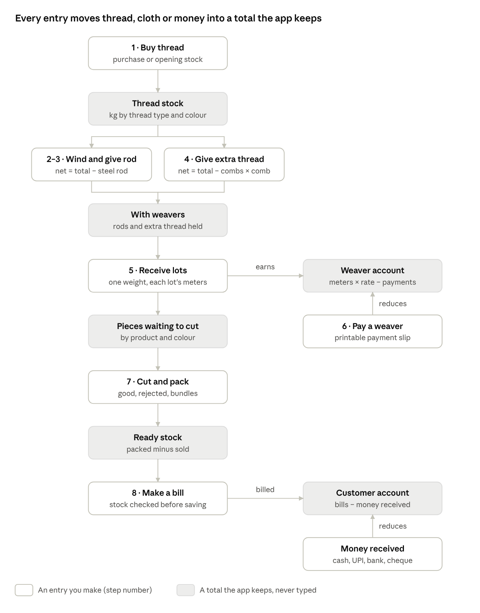
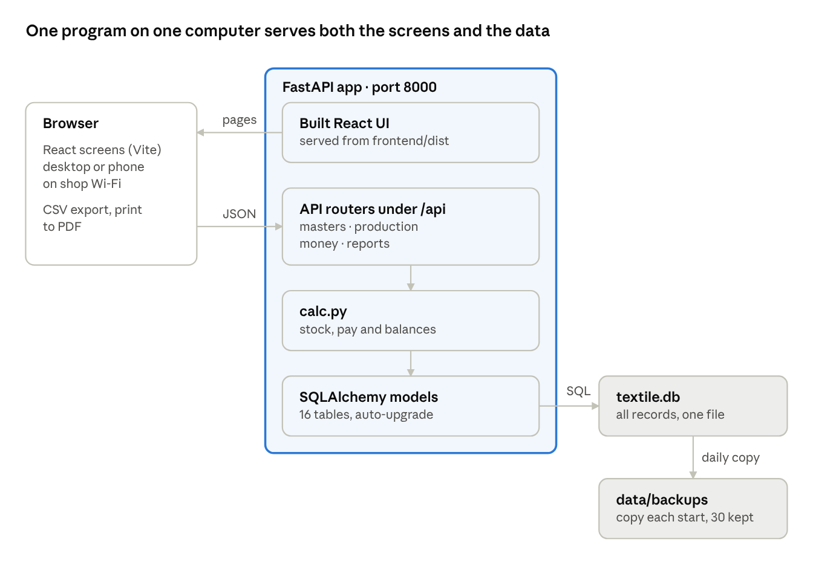

# Textile Records — Design Document

Oct 12, 2026 · @Mohith

> Product source of truth. Converted from `docs/Textile Records — Design Document-Overview.docx`.
> When a feature changes behaviour described here, the developer agent updates this file in the same branch.
> Where the built code differs from this design, see **Implementation notes (as built)** at the end. The code wins.

## Overview

Textile Records replaces the paper books of a towel and lungi job-work business with one local web app. It tracks every kilogram of thread and every piece of cloth from purchase to sale, and works out weaver pay, stock and customer balances automatically.

**Users.** The owner and his father enter records by hand, at a desk computer or on a phone at the shop. The father is not a regular computer user, so every screen favours large controls, plain words and visible calculations over density.

### Goals

- Replace every paper register: thread purchases, rods, extra thread, lots, weaver payments, cutting, sales, money received.
- Do all arithmetic in the app, shown on screen as it happens (net weights, weaver earnings, balances, stock).
- Trace any lot back to the rod and thread it came from.
- Keep the data safe on one computer with automatic backups, no internet needed.

### Non-goals

- Multi-branch or multi-user accounts with logins.
- GST filing, full accounting (expenses, salaries, electricity) or payroll.
- Automatic data capture from scales or barcode readers; all entry is manual by design.

## Business process

The app follows the business in eight numbered steps, the same order as the home screen; each step is an entry, and every shaded total in between is computed from those entries.

| Step | Entry | Feeds the total |
|---|---|---|
| 1 | Buy thread (purchase or opening stock) | Thread stock — kg by thread type and colour |
| 2–3 | Wind and give rod (net = total − steel rod) | With weavers — rods and extra thread held |
| 4 | Give extra thread (net = total − combs × comb) | With weavers |
| 5 | Receive lots (one weight, each lot's meters) | Pieces waiting to cut (by product and colour); earns → Weaver account |
| 6 | Pay a weaver (printable payment slip) | Weaver account = meters × rate − payments |
| 7 | Cut and pack (good, rejected, bundles) | Ready stock = packed − sold |
| 8 | Make a bill (stock checked before saving) | Customer account = bills − money received |
| — | Money received (cash, UPI, bank, cheque) | reduces Customer account |

Thread moves down the left column as kilograms, then cloth as pieces; money moves through the two accounts on the right. Steps 2–3 and 4 run side by side, since a weaver can hold rods and loose combs of thread at the same time.

## Architecture

One Python process (FastAPI on Uvicorn, port 8000) serves both the built React screens and the JSON API from a single SQLite file, so the whole system runs on one shop computer with no internet.

| Layer | Choice | Why |
|---|---|---|
| Screens | React 18, React Router 6, built with Vite 5; plain CSS | Fast on old hardware, no UI library to learn or update |
| Server | FastAPI, Pydantic 2, Uvicorn | Typed validation, clear error messages, auto API docs |
| Storage | SQLite through SQLAlchemy 2 | One file to back up and restore; no database server to install |
| Launch | `START-Windows.bat` / `start-mac-linux.sh` | Double-click: first run creates a Python virtual environment and installs packages, then opens the browser |

Request path: Browser → API routers under `/api` (masters · production · money · reports) → `calc.py` (stock, pay and balances) → SQLAlchemy models (16 tables, auto-upgrade) → `textile.db` → daily copy to `data/backups` (copy each start, 30 kept). The built React UI is served from `frontend/dist`.

Phones on the same Wi-Fi reach the app at the computer's address on port 8000. During development, Vite runs on port 5173 and forwards `/api` to the server.

## Data model

Sixteen SQLite tables hold every record; stock and balances are never stored but always computed from them, so a correction anywhere updates everything at once.

| Table | One row is | Key fields | Links to |
|---|---|---|---|
| suppliers | A thread seller | name, phone, GSTIN, payment terms | — |
| purchases | A thread purchase or opening stock | date, bill no, thread type, colour, kg, rate/kg, amount | supplier (empty = opening stock) |
| rods | Thread wound on a steel rod (code R-0001) | gross kg, rod kg, net kg, length (549 m default), design, status | weaver, machine, lots |
| thread_issues | Extra thread given to or taken back from a weaver | combs, gross kg, kg per empty comb, net kg, kind (given / returned) | weaver, machine |
| weavers | A job-work weaver | rate per meter, opening balance, active | machines |
| machines | A loom at a weaver's place | number, current colour, current design, active | weaver |
| lot_batches | One receipt from one machine, weighed together | date, combined weight kg | weaver, machine, lots |
| lots | One lot of cloth (code L-0001) | product, colour, design, pieces, meters, rate, amount | weaver, machine, batch, rods |
| lot_rods | Which rods a lot was woven from | lot, rod | — |
| weaver_payments | Money paid to a weaver | date, amount, mode (Cash / UPI / Bank / Cheque) | weaver |
| cutting_entries | A cutting and packing session | product, colour, good, rejected, bundles, source (woven / opening) | — |
| customers | A wholesale buyer | phone, address, GSTIN, opening balance | — |
| sales + sale_items | A bill (code INV-0001) and its lines | product, colour, quantity, rate, amount | customer |
| customer_payments | Money received from a customer | date, amount, mode | customer |
| settings | Business details and defaults | name, address, GSTIN, rod length, rod weight, comb weight | — |

**Opening balances.** Weavers and customers carry an opening balance, and purchases and cutting entries accept an "opening stock" source, so the app can start from the figures in the old books on day one.

**Matching names.** Thread type, colour and product are free text. All stock grouping ignores case and surrounding spaces, so "Red" and "red " count as one colour.

## Core calculations and business rules

Every figure the business used to work out by hand is computed on the server (`calc.py`) and previewed live on the form before saving.

- Net thread on a rod: `net_rod = gross weight − steel rod weight`
- Net extra thread on combs: `net_combs = gross weight − combs × weight of one empty comb`
- Thread stock for each thread type and colour: `stock = Σ purchased − Σ net_rod − (Σ given − Σ taken back)`
- **Weaver pay.** Each lot earns meters × the weaver's rate per meter, fixed on the lot when it is saved, so a later rate change does not rewrite past lots. Amount to pay = opening balance + all lot amounts − all payments; a negative figure is an advance.
- **Pieces waiting to cut** for each product and colour = pieces in all lots received − (good + rejected) in all cutting entries from weaving. Cutting is recorded by colour, not by lot, because lots of one colour are cut together.
- **Ready stock** for each product and colour = good pieces packed (including opening stock) − pieces sold.
- **Customer balance** = opening balance + all bills − all money received.
- **Rough profit** for a period = sales − thread purchases − weaving cost. It leaves out electricity, wages, transport and packing.

### Rules the app enforces

| Situation | What happens |
|---|---|
| Rod total weight ≤ rod weight, or comb total ≤ plastic weight | Refused with the reason |
| Rod or extra thread exceeds thread in stock | Saved, with a warning to check purchases |
| Lot pieces outside 35–50 | Warning on the form |
| Cutting more pieces than are waiting | Saved, with a warning |
| Bill for more pieces than are packed | Refused, showing what is available |
| Deleting a record others depend on (a cut lot, a weaver with lots, a sold cutting entry) | Refused, naming what to delete first |
| Money amounts | Rounded half up to 2 decimals, the same on screen and in the database |

## API design

A JSON REST API under `/api`, split into four routers; every list endpoint takes optional `from` and `to` dates, and interactive docs are served at `/docs`.

| Router | Endpoints | Purpose |
|---|---|---|
| masters.py | /settings, /suppliers, /weavers, /weavers/{id}/machines, /machines/{id}, /customers | People, machines and business details |
| production.py | /purchases, /thread-stock, /rods, /rods/issue, /rods/{id}/finish · return · reopen, /thread-issues, /lots, /cutting, /uncut-stock, /finished-stock | Material from thread to packed pieces |
| money.py | /weaver-dues, /weaver-payments, /weaver-payments/{id}/slip, /weavers/{id}/ledger, /sales, /customer-payments, /customers/{id}/ledger | Money in and out, slips, running accounts |
| reports.py | /dashboard, /reports/summary · weavers · machines · suppliers · sales · wastage, /backup | Home screen, reports, backup download |

### Conventions

- Request bodies are Pydantic models that trim spaces from text and check ranges (weights > 0, pieces ≥ 0).
- Errors return HTTP 400 with one plain sentence ("Not enough stock: only 38 pieces of Towel Red are packed and ready"), which the UI shows as is. Validation errors (422) are translated to field names on the client.
- A save that succeeds but needs attention returns the record plus a `warning` field.
- `POST /lots` takes one receipt: shared weaver, machine, product, colour and combined weight, plus a list of `{pieces, meters}` lines; it creates one batch and one lot per line.
- Codes (R-0001, L-0001, INV-0001) are assigned by the server from the row id.

## UI and UX design

The interface is built for someone who has never used business software: the home screen is the business process itself, and every number is explained where it appears.

### Principles

- **The flow is the menu.** The home screen shows eight numbered tiles in the order work happens (Buy thread → Wind a rod → Give rod → Give extra thread → Receive lots → Pay a weaver → Cut & pack → Make a bill). The sidebar repeats the same numbers.
- **Show the sum, not just the answer.** A coloured box under each form shows the formula with the user's numbers ("14.6 kg − (12 combs × 0.105 kg) = 13.34 kg") before saving.
- **Tap, don't type.** Big toggle buttons for Towel / Lungi and Cash / UPI; thread chips from stock; colour cards on the cutting screen; rods ticked automatically from the chosen machine.
- **Remember what repeats.** Steel rod weight and comb weight are remembered; date, weaver and product carry over to the next entry.
- **Large and plain.** 18 px base text, 54 px input height, plain words ("To pay now", "Pieces waiting to cut"), Indian number and date formats (₹1,23,456.00, 12-10-2026).
- **Confirm, then point onward.** A green banner names the new code (R-0008, L-0011) and links to the next step.

### Screens

| Screen | Tabs or views |
|---|---|
| Home | Step tiles, at-a-glance numbers, latest lots |
| Thread & suppliers | Thread stock · Buy thread · Purchase list · Suppliers |
| Rods & thread to weavers | Wind new rod · Give rods to weaver · Give extra thread · All rods |
| Weavers & machines | Weaver cards; each weaver's page with machines, rods held, extra thread, account |
| Lots received | Receive lots (one weight, many lots) · Lot list |
| Weaver payments | Who to pay · Pay a weaver · Payment history · printable slip |
| Cutting & stock | Cut & pack by colour · Ready stock · Cutting history |
| Sales & customers | New bill · Bills · Money received · Customers; printable bill; customer account |
| Reports | Summary, weavers, machines, suppliers, sales, wastage, for any date range |
| Settings & backup | Business details, defaults, backup download |

**Devices and output.** Below 900 px wide the sidebar becomes a slide-in menu and tables turn into stacked cards, so the app works on a phone over shop Wi-Fi. Every list exports to CSV for Excel and prints cleanly to PDF; bills and payment slips have their own print layouts with signature lines.

## Data safety

All records live in one file, `backend/data/textile.db`, protected by daily automatic copies and a one-click download.

- **Daily backup.** On every start the app copies the database to `data/backups/textile-YYYY-MM-DD.db` using SQLite's online backup, keeping the last 30 days. A failed backup is logged and never stops the app.
- **Manual backup.** Settings → Download backup now gives a dated copy to keep on a pen drive or Google Drive; restore = replace `textile.db` with it.
- **No silent loss.** Deletes ask for confirmation and are blocked when other records depend on them.
- **Upgrades in place.** On start, `upgrade_old_database()` adds any columns a newer version needs (comb fields, lot batches, cutting source) and fills defaults, so an older database keeps working when the app folder is replaced.

## Testing

Five automated tests (`backend/tests/test_flow.py`, run with pytest) cover the whole business flow on a fresh database, and every screen is checked in a headless browser.

- **Full flow:** buy thread → wind rod → issue → receive lot → pay → cut → bill → receive money, asserting every computed figure and the guarded deletes.
- **Extra thread:** given and taken back, stock and weaver holding, warnings.
- **Comb validation:** plastic heavier than total, zero combs, missing weight.
- **Many lots, one weight, cutting by colour:** totals, per-lot pay, pieces waiting, over-cut warning.
- **Upgrade:** builds a database in the first version's format and checks it opens with data intact.

Browser checks with Playwright fill the main forms, compare on-screen calculations with saved values, and fail on any console error, at desktop (1366 px) and phone (390 px) widths.

## Limitations and future work

The current design trades multi-user features for simplicity on a single shop computer.

| Limitation | Possible next step |
|---|---|
| No logins; anyone on the shop Wi-Fi can open it | A simple PIN screen |
| Data on one computer only | Scheduled copy of the backup to Google Drive |
| Entries are deleted and re-entered, not edited | Edit forms for lots, bills and payments |
| English labels only | A Malayalam / English switch |
| Rough profit ignores other expenses | An expenses register |
| Bills have no GST breakup | GST rates and tax lines on bills |
| No reminders for overdue customer balances | Ageing report and WhatsApp reminder text |

## Implementation notes (as built)

Differences between the original design above and the code in `main`. Agents keep this section current.

| Topic | Design said | Built as |
|---|---|---|
| Storage | SQLite only, one shop computer | SQLite when `DATABASE_URL` is empty; **PostgreSQL** (Neon / Supabase, psycopg 3) when set. The online deployment uses Postgres |
| Hosting | Local only | Also live at https://textile-records.onrender.com (Render), auto-deployed from `main` |
| Logins | None (non-goal) | Optional HTTP Basic login for the whole app when `APP_PASSWORD` is set (`APP_USERNAME`, default `admin`) |
| Money type | Rounded half up to 2 dp | `Float` columns, rounded half up via `util.r2()` on save and output; kg via `util.r3()` |
| Settings table | Columns for name, address, defaults | Key/value rows (`settings.key`, `settings.value`) |
| Schemas | — | Request models live inside each router file (subclass `util.In`); no separate `schemas.py` |
| Backups | `.db` copy | `.db` online-backup copy on SQLite; `.json` export of every table on Postgres. On Render, files on local disk do not survive restarts |
| Built UI | Served from `frontend/dist` | `frontend/dist` is **committed**; rebuild and commit it after every UI change |
| Config | — | `backend/.env` (see `.env.example`): `DATABASE_URL`, `DB_POOL_SIZE`, `DB_MAX_OVERFLOW`, `TEXTILE_DATA_DIR`, `TEXTILE_UI_DIR`, `APP_USERNAME`, `APP_PASSWORD`, `CORS_ORIGINS` |
| Browser tests | Playwright at 1366 / 390 px | Not present yet; backend has the five pytest tests |
